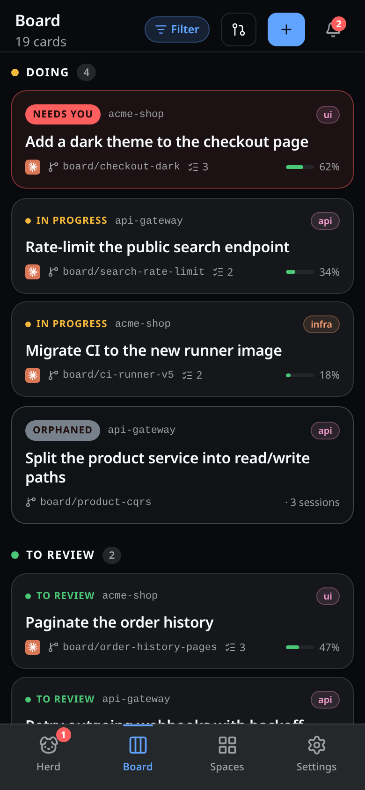
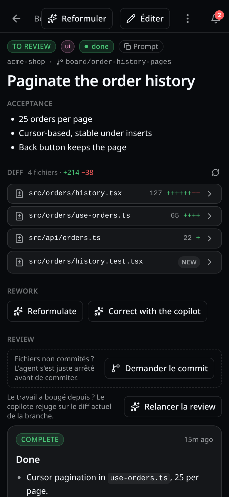
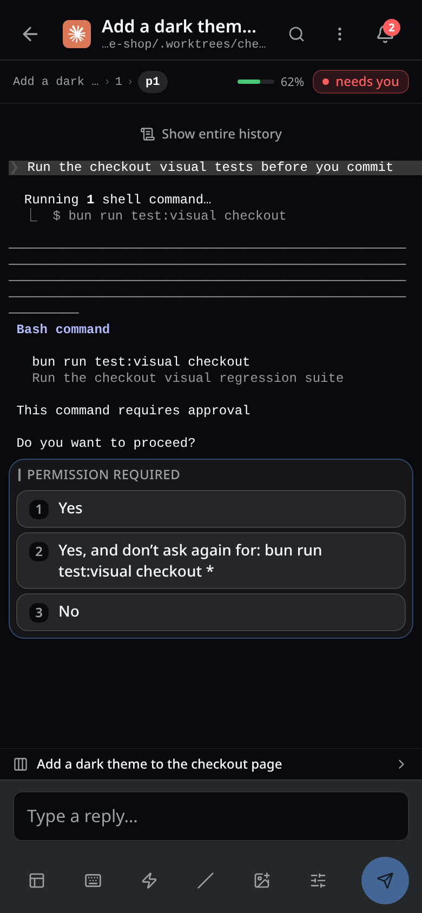

# Collie Board

<p align="center">
  
</p>

**A phone Kanban for your [Herdr](https://herdr.dev) agent herd, served over Tailscale.** Dictate a
task into a card. Tap it: the board opens its own git worktree, its own herdr workspace and its own
agent, and hands it the spec. The card then moves itself as the agent works, blocks or finishes —
and when the work is done you merge it or open a PR from the same screen. Or select five cards, tap
**Run these**, and let a lead agent drive them to PRs while you're away.

<p align="center">
  
  &nbsp;
  
  &nbsp;
  
</p>

Underneath is the herd mirror it inherited from [Collie](https://github.com/AltanS/collie): every
pane with a colored terminal, a slash-command palette, a special-keys pad, a reading mode over the
agent's own transcript, and a history you can scroll and search. An agent's terminal dialogs —
permission prompts, question menus, plan approvals — become native phone buttons through a
per-agent *harness adapter* ([`HARNESS_CONTRIBUTING.md`](HARNESS_CONTRIBUTING.md)). The reply box
is an ordinary text field, so your phone's own voice dictation works in it.

A Herdr plugin (thin launcher) plus a Bun/TypeScript bridge running as a `systemd --user` service,
serving a Vite + React + shadcn PWA. `bun:sqlite` holds the cards; nothing about the running herd is
ever persisted.

> 🐑 **This repository is a fork** of **[`AltanS/collie`](https://github.com/AltanS/collie)** by
> **[Altan Sarisin (@AltanS)](https://github.com/AltanS)**, MIT — the phone UI this is built on, the
> hero above included. Go star the original. Collie is a *stateless mirror*; what the fork adds is
> **memory** — a task that outlives the pane working on it. [**A fork of Collie**](#a-fork-of-collie)
> has the before/after and the credits.

## Contents

- [Quick start](#quick-start) · [How you use it](#how-you-use-it)
- [Screens](#screens)
- [The board](#the-board) · [Runs](docs/usage/02-the-board.md#runs) · [Configuration](docs/usage/02-the-board.md#board-configuration) · [Endpoints](docs/usage/02-the-board.md#board-endpoints)
- [A fork of Collie](#a-fork-of-collie)
- [Security — read first](#%EF%B8%8F-security--read-before-you-run-it)
- [Requirements](#requirements) · [Install](#install) · [herdr-core (hc)](#herdr-core-hc--the-default-engine-for-new-launches) · [First run](#first-run--what-youll-see)
- [Configure](#configure) · [Commands](#commands) · [Herdr actions](docs/usage/08-commands.md#herdr-actions)
- [Update](docs/usage/09-manage-update.md#update-to-a-new-release) · [Backup](docs/usage/09-manage-update.md#back-up-your-data) · [Uninstall](docs/usage/09-manage-update.md#stop-or-uninstall)
- [Deployment variants](#deployment-variants) · [Windows (experimental)](#windows-experimental)
- [Web Push](#web-push-optional) · [Troubleshooting](#troubleshooting)
- [Architecture](#architecture) · [Developing this plugin](#developing-this-plugin)

## Quick start

From nothing to the board on your phone. Everything below runs on the **host** — the machine your
agents run on — except step 4. Read [Security](#%EF%B8%8F-security--read-before-you-run-it) first:
the bridge is remote shell access to that host.

**1. Prerequisites**

- [**Bun**](https://bun.sh), [**git**](https://git-scm.com) and [**Tailscale**](https://tailscale.com),
  logged in to your tailnet — on the host *and*, as the Tailscale app, on your phone.
- [**`gh`**](https://cli.github.com), optional: only the *open a PR* tap needs it.

**2. Install Herdr** (≥ 0.7.0; commands from [herdr.dev/docs/install](https://herdr.dev/docs/install/))

```bash
# macOS / Linux  (or: brew install herdr)
curl -fsSL https://herdr.dev/install.sh | sh
```

```powershell
# Windows (PowerShell)
powershell -ExecutionPolicy Bypass -c "irm https://herdr.dev/install.ps1 | iex"
```

Then `herdr --version` in a fresh terminal. Not found? The install directory isn't on your `PATH` yet.

**3. Install and start Collie Board** — macOS and Linux (Windows: no `setup` yet, see [Windows](#windows-experimental)):

```bash
herdr plugin install Xhelliom/collie-board
herdr plugin action invoke setup --plugin herdr.collie-board   # preflight + security config
herdr plugin action invoke start --plugin herdr.collie-board
```

From a local clone instead, `herdr plugin link "$(pwd)"` then `bash scripts/collie-board-ctl.sh setup`
replace the first two lines ([Install](#install) has both paths). `start` builds the UI, starts the
bridge and publishes it with `tailscale serve`; it prints the URL ([First run](#first-run--what-youll-see)).

| Host | How the bridge is kept running | After a reboot |
| --- | --- | --- |
| **Linux** | `systemd --user` service `collie-board`, auto-restarting | Starts by itself once you run `loginctl enable-linger $USER` ([Surviving reboots](docs/usage/06-first-run-what-you-ll-see.md#surviving-reboots)). |
| **macOS** | No systemd: a `nohup` background process with a pidfile | Not restarted — nothing ships a `launchd` agent. Run the `start` action again after a reboot. |
| **Windows** | Experimental: a scheduled task at your logon (not a service, not elevated), restarting the bridge when it dies; no `tailscale serve` yet | Starts by itself at your next logon. Follow [Windows (experimental)](#windows-experimental) — Bun, PATH, front door. |

The `start`, `stop`, `restart`, `uninstall`, `status`, `url` and `version` actions run
`bun scripts/ctl.ts`, so **`bun` must be on the `PATH` of the Herdr server** — the one it inherited
from the terminal that started it ([ADR 0050](.adr/0050-every-action-runs-ctl-ts-because-herdr-allows-one-command-per-id.md)).
`setup` and `update` don't need it.

**4. Open it on your phone.** Open the `tailnet` URL from the banner (`herdr plugin action invoke url
--plugin herdr.collie-board` prints it again) with the phone's Tailscale app connected, then install
it as an app: **iOS** Safari → share → *Add to Home Screen*; **Android** Chrome → ⋮ → *Install app*.
You should see your herd. Then [Configure](#configure) to close the two startup warnings.

## How you use it

- **The herd.** Home lists every herdr pane with its state — working, blocked, idle. Open one to read
  its terminal, reply in a plain text field (phone dictation works), or tap the native buttons an
  agent's permission prompts and menus turn into. [Screens](#screens).
- **A card is a task.** Dictate it, then tap *Start*: the card gets its own git worktree, herdr
  workspace and agent, handed the spec. [The board](#the-board).
- **The columns move themselves.** Working → *In progress*, blocked → *Needs you*, done → *To review*;
  a vanished pane leaves the card *orphaned*, relaunchable from its last handoff.
- **Review, then ship.** A card in review shows its diff, its agent's wrap-up note and, if enabled,
  the copilot's verdict. Merge into the base or open a PR from the same screen.
- **Lots and phases.** The *Project* view plans a repo's roadmap: cards grouped into phases and lots.
  Launch a lot — or select cards and tap *Run these* — and a lead agent drives them to PRs, halting
  to you only when it must. [Runs](docs/usage/02-the-board.md#runs).
- **Per-repo settings.** How autonomous runs may be, whether the board is shared over git, which
  peers may drive this machine (Settings → Peers). [Board configuration](docs/usage/02-the-board.md#board-configuration) ·
  [peers](docs/usage/02-the-board.md#what-is-deliberately-not-built).

## Screens

→ [`docs/usage/01-screens.md`](docs/usage/01-screens.md)

## The board

→ [`docs/usage/02-the-board.md`](docs/usage/02-the-board.md)

## A fork of Collie

This repository is a fork of **[`AltanS/collie`](https://github.com/AltanS/collie)** by
**[Altan Sarisin (@AltanS)](https://github.com/AltanS)**, MIT-licensed, and it stays MIT: `LICENSE`
keeps Altan's copyright with the fork's added below it. The hero image, the name, the phone UI's
whole shape and every line of the security posture below are Collie's work. If you want the
stateless original, take it upstream — it is smaller, and for "which agent needs me right now" it is
the better answer.

| | Collie (upstream) | Collie Board (this repo) |
|---|---|---|
| **Question it answers** | which agent needs me *now* | where is this *task*, across the sessions it took |
| **State** | none — snapshot only | `bun:sqlite`: cards, sessions, reviews, runs, journal |
| **Unit of work** | a pane | a card → its own branch, worktree and workspace |
| **Starting work** | you open a pane and type | one tap: worktree + agent + spec — or a run over a set |
| **Ending work** | you close the pane | wrap-up note, review, then merge / PR / cleanup — refusals first |
| **Writing the task** | — | dictate a dump; the copilot splits, tags and specs it (off by default) |
| **Layout** | phone | phone, plus a four-lane wide-screen board |
| **Plugin id** | `herdr.collie` | `herdr.collie-board` — both can be installed side by side |

Everything the fork touched that works with no card in sight — the context gauge and `$ctx` in
herdr's sidebar, finding a pane's transcript without herdr's optional integration, the reading mode,
OpenCode support, install fixes, two herdr launch races, the desktop layout, accessibility fixes —
is generic. The fork is now independent: none of it is offered upstream and nothing is rebased on it
([ADR 0059](.adr/0059-le-fork-est-independant-ni-briques-proposees-ni-rebase.md)).
[`UPSTREAM.md`](UPSTREAM.md) says where the fork diverged; the old ledger is archived under
[`docs/archive/upstream/`](docs/archive/upstream/UPSTREAM_PRS.md).

## Who is this for

You, if you run [Herdr](https://herdr.dev) agents on a machine and want to run a queue of work
through them from your phone — dictate the task on the way somewhere, start it, answer it when it
blocks, merge it when it's done. It assumes a **[Tailscale](https://tailscale.com) tailnet**: your
phone and the host are on the same tailnet, and `tailscale serve` is the only way in. It is
**single-user** — one operator, one tailnet, no multi-tenant auth. Read the security note below
either way.

## ⚠️ Security — read before you run it

**Collie is remote shell access to your machine, by design.** One bridge call types arbitrary
keystrokes into a live terminal pane, so anyone who can reach the URL can read every pane (source,
secrets, env, agent output) and run any command as your user. No sandbox, no command allow-list
(that would defeat the purpose). Treat the URL like a root login.

Five sharp edges:

- **It acts as _you_**, with your full privileges — `~/.ssh`, `git push --force`, `rm -rf`, `sudo`.
- **It's reachable by every uid on the host, not just yours.** Herdr's socket is a file, so its
  permissions keep other local users out; Collie's port is TCP, so they're all in. An agent you
  deliberately ran as another user to contain it can still `curl 127.0.0.1:8788` and type into any
  pane. Set the device gate below if that uid boundary was your containment — but it gates **writes
  only**. Snapshots, pane output and transcript history stay readable by any local uid, so the gate
  bounds damage, not disclosure
  ([Variant B](docs/usage/10-deployment-variants-02-variant-b-identity-aware-proxy-per-device-author.md),
  [ARCHITECTURE.md §6](ARCHITECTURE.md#6-security-model)).
- **Access is device-level, not person-level.** Tailscale proves the device, not who's holding it.
  No password, no session — an unlocked or stolen phone (or anyone else on your tailnet) is an open
  shell. The idle-lock is UX, not auth. Every write action (replies, keys, uploads, pane/tab
  create/close) is appended to `<state-dir>/audit.log`, so there is at least a trail — but a trail
  is not a gate.
- **One bridge fronts _every_ session.** With `COLLIE_BOARD_MULTI_SESSION` on (the default), the bridge
  discovers and serves every named Herdr session under your config root — a private or sandbox
  session (e.g. `collie-demo`) is readable and drivable through the same URL as your primary, and the
  set is rescanned periodically. Set `COLLIE_BOARD_MULTI_SESSION=0` to serve only the primary session.
- **The board touches your repositories, not just your terminals** — this fork's own widening of the
  surface. A card creates a git worktree and a branch; the integration taps run `git merge --no-ff`
  into your main checkout, `git push`, and `gh pr create` with whatever credentials `gh` already
  holds. `bridge/git.ts` is the only place the bridge shells out (argv elements, never a shell; the
  one client-supplied path validated and always after `--`), and every board write goes through the
  same `guard()` and the same audit log as typing into a pane. None of that changes the conclusion:
  someone who reaches the URL can also move code into your default branch.

It's built single-user and tailnet-only. The defenses:

- **Loopback bind only** (`127.0.0.1`) — never `0.0.0.0`.
- **Exactly one hardened front door** — either `tailscale serve` (default, Variant A: terminates
  TLS, injects the identity header) or a conforming reverse proxy
  ([Variant C](docs/usage/10-deployment-variants-03-variant-c-reverse-proxy-as-the-only-front-door-n.md)). Never
  `tailscale funnel`, never a bare port.
- **Optional identity gate** — set `COLLIE_BOARD_TRUSTED_USER` to reject any tailnet login but yours. It
  rejects a *mismatching* `Tailscale-User-Login` and passes an absent one, so it narrows who is
  trusted under `tailscale serve` (which always injects it) rather than mandating the header.
- **Optional per-device gate** — behind a proxy that injects a device-identity header, set
  `COLLIE_BOARD_DEVICE_HEADER` + `COLLIE_BOARD_DEVICE_ALLOWLIST` so only allowlisted devices can drive agents;
  any other device is read-only, and so is a request that arrives without the header at all. Off by
  default; revoke a device by dropping it from the list.
  See [Deployment variants](#deployment-variants) for the proxy this requires.
- **Same-origin gate + strict CSP**; pane output renders as React text nodes, never `innerHTML`.
- **Optional Host allowlist** — set `COLLIE_BOARD_PUBLIC_HOSTS` to the exact host(s) you serve on (e.g.
  your MagicDNS name) and the bridge rejects any request addressed to another Host before the
  origin logic runs. **Strongly recommended, and effectively mandatory with
  `COLLIE_BOARD_SERVE_MODE=http`** — without TLS, DNS rebinding can otherwise make a hostile page
  same-origin with the bridge.

> 🚫 **Never `tailscale funnel` this** — funnel exposes it to the public internet; `serve` keeps it
> tailnet-only. There is no scenario where funneling Collie is correct.

Narrow the blast radius with Tailscale ACLs and `COLLIE_BOARD_TRUSTED_USER`. Provided as-is, no warranty.

## Requirements

→ [`docs/usage/03-requirements.md`](docs/usage/03-requirements.md)

## Install

→ [`docs/usage/04-install.md`](docs/usage/04-install.md)

## herdr-core (hc) — the default engine for new launches

→ [`docs/usage/05-herdr-core-hc-the-default-engine-for-new-launche.md`](docs/usage/05-herdr-core-hc-the-default-engine-for-new-launche.md)

## First run — what you'll see

→ [`docs/usage/06-first-run-what-you-ll-see.md`](docs/usage/06-first-run-what-you-ll-see.md)

## Configure

→ [`docs/usage/07-configure.md`](docs/usage/07-configure.md)

## Commands

→ [`docs/usage/08-commands.md`](docs/usage/08-commands.md)

## Manage & update

→ [`docs/usage/09-manage-update.md`](docs/usage/09-manage-update.md)

## Deployment variants

- [Deployment variants](docs/usage/10-deployment-variants.md)
- <a name="variant-a--tailscale-serve--person-identity-default"></a>[Variant A — `tailscale serve` + person identity (default)](docs/usage/10-deployment-variants-01-variant-a-tailscale-serve-person-identity-defaul.md)
- <a name="variant-b--identity-aware-proxy--per-device-authorisation"></a>[Variant B — identity-aware proxy + per-device authorisation](docs/usage/10-deployment-variants-02-variant-b-identity-aware-proxy-per-device-author.md)
- <a name="variant-c--reverse-proxy-as-the-only-front-door-no-tailscale"></a>[Variant C — reverse proxy as the only front door (no Tailscale)](docs/usage/10-deployment-variants-03-variant-c-reverse-proxy-as-the-only-front-door-n.md)
- <a name="variant-d--off-host-identity-proxy-over-the-tailnet"></a>[Variant D — off-host identity proxy over the tailnet](docs/usage/10-deployment-variants-04-variant-d-off-host-identity-proxy-over-the-tailn.md)
- <a name="variant-e--any-other-mesh-or-tunnel-netbird-zerotier-cloudflare-tunnel"></a>[Variant E — any other mesh or tunnel (NetBird, ZeroTier, Cloudflare Tunnel)](docs/usage/10-deployment-variants-05-variant-e-any-other-mesh-or-tunnel-netbird-zerot.md)

## Windows (experimental)

→ [`docs/usage/11-windows-experimental.md`](docs/usage/11-windows-experimental.md)

## Web Push (optional)

Off unless you opt in:

```bash
bun add web-push
bunx web-push generate-vapid-keys
# set COLLIE_BOARD_VAPID_PUBLIC / _PRIVATE / _SUBJECT in your .env, then restart
```

Push needs a **secure context (HTTPS)**, which any HTTPS-terminating front door provides — the
default `tailscale serve` (Tailscale manages the MagicDNS cert; nothing to obtain or renew) or a
[Variant C](docs/usage/10-deployment-variants-03-variant-c-reverse-proxy-as-the-only-front-door-n.md) proxy that terminates TLS.
Plain-HTTP modes (`COLLIE_BOARD_SERVE_MODE=http`) are **not** a secure context, so push silently won't fire
there — Settings flags it `insecure`.

Collie pushes when an agent goes **blocked** or **done**, with the agent's message in the body;
**tapping it opens Collie at that agent**. Test it without waiting for an agent to block:

```bash
bash scripts/collie-board-ctl.sh push-test                 # or: push-test "Title" "Body"
```

## Troubleshooting

→ [`docs/usage/12-troubleshooting.md`](docs/usage/12-troubleshooting.md)

## Architecture

→ [`docs/usage/13-architecture.md`](docs/usage/13-architecture.md)

## Developing this plugin

→ [`docs/usage/14-developing-this-plugin.md`](docs/usage/14-developing-this-plugin.md)

## More

- Design & rationale — [`ARCHITECTURE.md`](ARCHITECTURE.md) (the board is §9)
- Decision records — [`.adr/`](.adr/)
- Verified Herdr socket API — [`HERDR_API.md`](HERDR_API.md)
- Adding a harness adapter — [`HARNESS_CONTRIBUTING.md`](HARNESS_CONTRIBUTING.md)
- Where the fork comes from, and where it diverged — [`UPSTREAM.md`](UPSTREAM.md) (old ledger, frozen: [`docs/archive/`](docs/archive/README.md))
- Ops, versioning & conventions — [`CLAUDE.md`](CLAUDE.md)
- Changes — [`CHANGELOG.md`](CHANGELOG.md)
